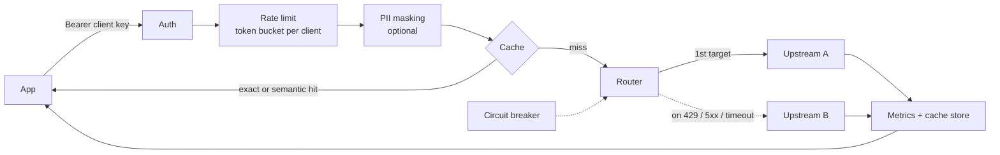

# LLM Gateway

A small OpenAI-compatible proxy that sits between your applications and model providers. Apps call one endpoint with one key; the gateway handles **fallback between providers, response caching (exact and semantic), per-client rate limits, PII masking and usage metrics**.

Point any OpenAI SDK at it by changing the base URL:

```python
from openai import OpenAI

client = OpenAI(base_url="http://localhost:8080/v1", api_key="<your gateway client key>")
client.chat.completions.create(model="fast", messages=[{"role": "user", "content": "Hello"}])
```

`fast` is an alias. Which provider and model actually serve it is gateway configuration, so switching or adding a provider needs no application change.

## Request path



| Stage | Behaviour |
|---|---|
| **Auth** | Each client has its own bearer token (read from an env var), compared in constant time. Upstream keys never leave the gateway. |
| **Rate limit** | Token bucket per client (`rpm`). Over the limit → `429` with `Retry-After`; the request never reaches a provider. |
| **PII masking** | Optional. Emails, phone numbers and Luhn-valid card numbers are replaced with `[EMAIL]`, `[PHONE]`, `[CARD]` before the prompt is forwarded. |
| **Cache** | Exact match first, then semantic match (see below). Private per client. |
| **Routing** | Targets are tried in order. Network errors, timeouts, `429`, `5xx` and upstream `401/403` (a bad provider key is the gateway's problem) move on to the next target. Other `4xx` are returned to the caller — a malformed request fails everywhere. |
| **Circuit breaker** | After N consecutive failures an upstream is skipped for a cooldown, then probed with one request. |
| **Streaming** | `stream: true` is relayed chunk by chunk. Fallback can happen until the first byte is sent; streamed responses are not cached. |

Response headers tell the caller what happened: `x-gateway-cache: miss | exact | semantic`, `x-gateway-upstream`, `x-gateway-attempts`, `x-gateway-similarity`.

## Semantic caching without wrong answers

Returning a cached reply for a *similar* prompt is the one feature here that can make a system silently incorrect. A semantic hit must clear four bars:

1. **Same scope** — same client, model alias and sampling parameters, and every message before the final user turn is identical. A different system prompt or conversation history is a different question.
2. **Similarity** — cosine similarity of the final user turn ≥ `semantic_threshold` (default 0.92).
3. **Same numbers** — the digit sequences must match exactly. "Where is order 1042?" is never answered with order 1043's reply, however similar the text.
4. **Same polarity** — a prompt containing a negation cannot reuse the answer to one without it.

Requests with tools, `n > 1` or streaming are never cached, and a caller can opt out per request with the `x-gateway-no-cache` header. The test suite includes look-alike pairs that pass the similarity bar alone and asserts that the guards reject them.

The built-in embedder is feature hashing over words and bigrams: deterministic, no model download, and deliberately lexical — at a high threshold it matches re-wordings that differ in case, punctuation and filler, not paraphrases. That is the conservative end of the trade-off; plugging in a neural embedding model would raise the hit rate and the risk together.

## Try it locally (no API keys)

```bash
pip install -e ".[dev]"
pytest                               # 47 tests, no network

# two fake providers; the first one is "down"
FAIL=1 UPSTREAM_NAME=primary uvicorn examples.fake_upstream:app --port 9001 &
UPSTREAM_NAME=backup uvicorn examples.fake_upstream:app --port 9002 &

GATEWAY_KEY_DEMO=demo-key GATEWAY_CONFIG=examples/local-demo.yaml \
  uvicorn gateway.app:app_from_env --factory --port 9000 &

curl -si localhost:9000/v1/chat/completions -H "Authorization: Bearer demo-key" \
  -H "Content-Type: application/json" \
  -d '{"model":"fast","messages":[{"role":"user","content":"What is the refund window? Mail me at asha@example.com"}]}'
```

The first call falls back and masks the email; sending it again is served from cache:

```
x-gateway-upstream: backup   x-gateway-attempts: 2   x-gateway-cache: miss
{"choices":[{"message":{"content":"[backup/small-b] You asked: What is the refund window? Mail me at [EMAIL]"}}], ...}

x-gateway-cache: exact   x-gateway-similarity: 1.000
```

`GET /metrics` (Prometheus text format) after those calls:

```
gateway_cache_hits_total{kind="exact"} 1
gateway_fallbacks_total{model="fast"} 1
gateway_pii_redactions_total{kind="email"} 2
gateway_requests_total{client="demo",model="fast",outcome="cache"} 1
gateway_requests_total{client="demo",model="fast",outcome="ok"} 1
gateway_tokens_total{client="demo",direction="input",model="fast"} 11
gateway_tokens_total{client="demo",direction="output",model="fast"} 18
gateway_upstream_errors_total{upstream="primary"} 1
```

## Configuration

Copy [`gateway.example.yaml`](gateway.example.yaml) to `gateway.yaml`. Secrets are referenced by environment-variable name and never written in the file.

```yaml
clients:
  - { name: web-app, key_env: GATEWAY_KEY_WEB, rpm: 120 }
upstreams:
  primary: { base_url: https://api.openai.com/v1, api_key_env: OPENAI_API_KEY }
  backup:  { base_url: https://api.groq.com/openai/v1, api_key_env: GROQ_API_KEY }
routes:
  fast:
    - { upstream: primary, model: your-small-model }
    - { upstream: backup,  model: your-backup-model }
cache:   { ttl_seconds: 3600, max_entries: 5000, semantic: true, semantic_threshold: 0.92 }
breaker: { failure_threshold: 3, cooldown_seconds: 30 }
redact_pii: false
```

Any provider with an OpenAI-compatible chat-completions endpoint works as an upstream. The config is validated at start-up: a route that names an unknown upstream fails fast.

```bash
docker build -t llm-gateway .
docker run -p 8080:8080 -v $PWD/gateway.yaml:/config/gateway.yaml --env-file .env llm-gateway
```

## Endpoints

| | |
|---|---|
| `POST /v1/chat/completions` | OpenAI-compatible; `model` is a route alias |
| `GET /v1/models` | The aliases this gateway serves |
| `GET /healthz` | Circuit state per upstream, cache size |
| `GET /metrics` | Prometheus counters: requests, cache hits, fallbacks, upstream errors, tokens per client and alias, rate-limit rejections, PII redactions |

Errors use the OpenAI error envelope (`{"error": {"message", "type", "code"}}`) so client SDKs raise their normal exceptions. When every upstream fails the gateway returns `502` with the list of attempts — upstream names and status codes only.

## Limitations

- **Single process.** Cache, rate-limit buckets and breaker state live in memory, so they are per-instance and reset on restart. Running several replicas needs a shared store such as Redis behind the same three interfaces.
- `/metrics` and `/healthz` are unauthenticated; expose them only on an internal network.
- PII masking is pattern-based (emails, phone-like numbers, Luhn-valid card numbers). It will miss names and addresses and is not a compliance control. Phone detection is a heuristic.
- Only chat completions are proxied — no embeddings, images or the Responses API.
- Token metrics come from the upstream `usage` field; streamed responses are not counted.
- Tested with mocked upstreams and the local fake provider, not against live provider APIs.

## License

MIT
